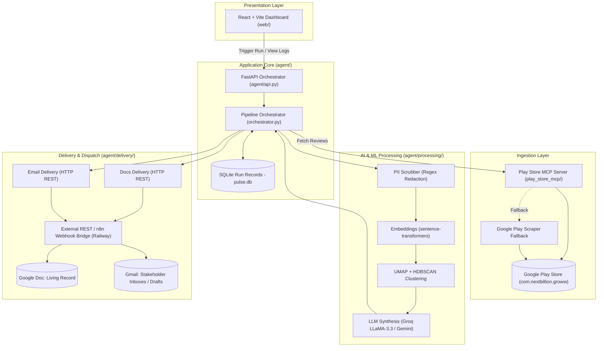

# Groww Pulse 📈⚡
### Automated Weekly App Review Intelligence & Executive Stakeholder Reporting

[](https://www.python.org/)
[](https://fastapi.tiangolo.com/)
[](https://react.dev/)
[](https://vitejs.dev/)
[](https://modelcontextprotocol.io/)
[](https://www.docker.com/)
[](https://railway.app/)

**Groww Pulse** is an end-to-end autonomous intelligence pipeline designed for Product Managers, Customer Experience teams, and Engineering leadership. It replaces manual app store feedback analysis by automatically ingesting hundreds of public Google Play Store reviews, sanitizing PII, discovering organic feedback themes via unsupervised machine learning, synthesizing executive-ready action items using advanced LLMs, and delivering structured reports into Google Docs and stakeholder inboxes.

---

## 📑 Table of Contents

- [Key Features](#-key-features)
- [System Architecture](#-system-architecture)
- [Pipeline Workflow (Step-by-Step)](#-pipeline-workflow-step-by-step)
- [Tech Stack](#-tech-stack)
- [Repository Structure](#-repository-structure)
- [Configuration & Environment Variables](#-configuration--environment-variables)
- [Quickstart: Local Development](#-quickstart-local-development)
- [Running via CLI & Scripts](#-running-via-cli--scripts)
- [Running the Test Suite](#-running-the-test-suite)
- [Deployment (Docker & Railway)](#-deployment-docker--railway)
- [Delivery Integrations & n8n Bridge](#-delivery-integrations--n8n-bridge)
- [Compliance & Grading Rubric Alignment](#-compliance--grading-rubric-alignment)

---

## 🌟 Key Features

* **🔌 Native MCP Architecture:** Review ingestion runs through a dedicated, project-owned Model Context Protocol (`play_store_mcp`) server over `stdio` with automatic fallback to store scrapers.
* **🛡️ Strict PII Scrubbing:** All raw review strings are stripped of personally identifiable information (emails, phone numbers, URLs, user handles) before vectorization or LLM prompt ingestion.
* **🧠 Unsupervised Topic Clustering:** Uses dense vector embeddings (`sentence-transformers/all-MiniLM-L6-v2`) combined with **UMAP** dimensionality reduction and **HDBSCAN** density clustering to find authentic user themes without hardcoded keyword filters.
* **🤖 Precision LLM Summaries:** Powered by Groq LLaMA-3.3-70B (or Google Gemini Flash), producing max 5 high-impact themes, verbatim validated quotes, sentiment indicators, and tactical PM action ideas.
* **📄 Automated Google Docs Append:** Keeps a single living Google Doc as the central system of record, appending dated sections with unique heading anchors for non-destructive history.
* **📬 Gmail Stakeholder Notifications:** Directly sends emails or generates Gmail drafts containing concise executive teasers and deep-links to the newly added Google Doc section.
* **🔒 Idempotent & Auditable:** Guarantees that running the same ISO week never produces duplicate doc sections or repeat emails. Every run logs review counts, token costs, anchors, and execution states in SQLite.
* **🖥️ Interactive React Dashboard:** Modern dark-mode UI with live status polling, run logs, trigger controls, and instant links to published reports.

---

## 🏗️ System Architecture



---

## 🔄 Pipeline Workflow (Step-by-Step)

1. **Trigger & Idempotency Check:**
   - The user triggers a pulse run for a specific ISO week (e.g., `2026-W45`) via the Web UI or CLI.
   - The orchestrator queries SQLite. If a `success` record already exists for that week and `--force` is not set, execution halts immediately to prevent duplicate runs.
2. **Ingestion via MCP:**
   - The orchestrator spawns a sub-process connecting to `play_store_mcp.server` via `stdio` transport.
   - The MCP tool `fetch_reviews` retrieves up to 500 recent user reviews with ratings, timestamps, and helpfulness upvotes.
3. **PII Sanitization & CSV Export:**
   - Reviews pass through `pii_scrubber.py` to remove sensitive user information.
   - Raw sanitized reviews are saved to `data/reviews_export.csv` for audit trails and offline data analysis.
4. **Vectorization & Clustering:**
   - Clean review texts are converted into 384-dimensional dense vectors using `sentence-transformers/all-MiniLM-L6-v2`.
   - **UMAP** reduces dimensionality to 5 components to preserve semantic neighborhoods.
   - **HDBSCAN** clusters dense groups of reviews, filtering noise (-1) and grouping similar praise or complaints organically.
5. **LLM Synthesis & Quote Validation:**
   - Clustered reviews are dispatched to the LLM (Groq LLaMA-3.3-70B or Gemini).
   - Generates up to 5 concise themes, tags sentiment (🔴 Negative, 🟡 Neutral, 🟢 Positive), formulates actionable PM recommendations, and extracts verbatim quotes.
   - `validator.py` cross-checks extracted quotes against original review strings using fuzzy string matching to eliminate hallucinations.
6. **Rendering & Multi-Channel Delivery:**
   - `report_renderer.py` constructs a structured markdown document section with a stable anchor ID (`#groww-pulse-<iso_week>`).
   - `email_renderer.py` generates an HTML teaser email with summary bullet points and deep links.
   - The delivery client pushes content to the configured REST/n8n bridge on Railway, appending to the shared Google Doc and generating Gmail drafts or sending emails directly.
7. **Audit Record Finalization:**
   - The SQLite database record is updated with completed timestamps, cluster counts, document IDs, email message IDs, and final execution status (`success`, `partial`, or `error`).

---

## 🛠️ Tech Stack

| Domain | Technology / Library | Role in Project |
| :--- | :--- | :--- |
| **Backend Framework** | **FastAPI + Uvicorn** | REST API for dashboard interaction, background task runner |
| **Agent Ingestion** | **MCP (Model Context Protocol)** | Standardized protocol to interface with Play Store scraper service |
| **Language & Runtime**| **Python 3.11** | Core agent logic, pipeline processing, async orchestrator |
| **NLP & Vectors** | **Sentence-Transformers** | Local dense semantic embedding generation (`all-MiniLM-L6-v2`) |
| **Machine Learning** | **UMAP + HDBSCAN** | Non-linear dimensionality reduction and density-based clustering |
| **LLM Inference** | **Groq API / Gemini** | High-throughput summarization via LLaMA-3.3-70B / Gemini Flash |
| **Frontend UI** | **React 18 + Vite** | Dark-mode single page application for monitoring and triggers |
| **Styling** | **Modern CSS3 (Vanilla)** | Zero-overhead, responsive dashboard styling |
| **Database** | **SQLite 3** | Local persistence for historical runs, status, and audit metrics |
| **Containerization** | **Docker** | Multi-stage build packaging both Node frontend and Python backend |
| **Hosting & Cloud** | **Railway** | Production cloud host with persistent volume support |
| **Delivery Bridge** | **REST / n8n Webhook** | Headless bridge for Google Docs API appends and Gmail dispatch |

---

## 📂 Repository Structure

```
Groww/
├── agent/                         # Core Python Agent Package
│   ├── delivery/                  # External delivery handlers (Google Docs, Gmail)
│   │   ├── docs_delivery.py       # Dispatches append requests to REST/n8n bridge
│   │   ├── email_delivery.py      # Dispatches draft/send requests to REST/n8n bridge
│   │   └── models.py              # Pydantic data models for delivery results
│   ├── ingestion/                 # MCP client connectors
│   │   └── ingestion.py           # Calls Play Store MCP tools with retry logic
│   ├── models/                    # Domain data types
│   │   └── types.py               # Review, Cluster, Theme, PulseReport, RunRecord
│   ├── processing/                # AI/ML analytics pipeline
│   │   ├── clustering.py          # UMAP reduction and HDBSCAN clustering
│   │   ├── embeddings.py          # Sentence-transformer embeddings generator
│   │   ├── pii_scrubber.py        # Regex pattern matching and PII redaction
│   │   ├── pipeline.py            # End-to-end processing pipeline orchestrator
│   │   ├── summarizer.py          # Groq / Gemini LLM prompt execution
│   │   └── validator.py           # Levenshtein/fuzzy quote validation
│   ├── rendering/                 # Content formatting
│   │   ├── email_renderer.py      # HTML teaser email generator
│   │   ├── models.py              # DocContent and EmailContent types
│   │   └── report_renderer.py     # Markdown Google Doc report formatter
│   ├── api.py                     # FastAPI routes for React dashboard
│   ├── config.py                  # Pydantic configuration loader
│   ├── logger.py                  # Structured JSON/Console logging setup
│   ├── orchestrator.py            # Main entrypoint executing the full batch lifecycle
│   └── run_record.py              # SQLite persistence layer for run metadata
├── config/                        # Schema validation definitions
├── data/                          # Runtime persistent storage (SQLite, CSV exports)
├── docs/                          # Architectural documentation & problem statements
│   ├── architecture.md            # In-depth architectural specification
│   ├── edge-case.md               # Edge cases and failure recovery strategies
│   ├── implementation-plan.md     # Multi-phase engineering roadmap
│   └── problemStatement.md        # Original design goals and stakeholder rubric
├── play_store_mcp/                # Project-owned MCP Server
│   ├── server.py                  # MCP server running over stdio
│   └── scraper.py                 # Google Play store review fetching logic
├── tests/                         # Pytest test suite
│   ├── test_agent/                # Unit tests for clustering, PII, summarizer, delivery
│   └── test_play_store_mcp/       # Unit and integration tests for MCP server
├── web/                           # React + Vite Frontend
│   ├── src/                       # React components, UI hooks, and CSS
│   ├── index.html                 # Single page application template
│   ├── package.json               # Node dependency manifest
│   └── vite.config.js             # Vite build configuration
├── config.json                    # Central project configuration
├── Dockerfile                     # Multi-stage production container build
├── mcp_servers.json               # MCP client connection registration
├── pyproject.toml                 # Python project packaging configuration
├── railway.json                   # Railway deployment specification
├── requirements.txt               # Pinned Python package dependencies
├── run_phase4.py                  # Standalone test script for full pipeline
├── scratch_trigger.py             # Developer test trigger script
└── start_ui.bat                   # Windows batch script to launch both UI & API
```

---

## ⚙️ Configuration & Environment Variables

### 1. `.env` File
Create a `.env` file in the project root:

```env
# LLM Provider API Keys (Pick Groq or Gemini)
GROQ_API_KEY=gsk_your_groq_api_key_here
GEMINI_API_KEY=your_gemini_api_key_here

# MCP & Service Authentication
MCP_API_SECRET_KEY=super_secret_internal_key

# External Delivery REST / n8n Server URL (Railway)
REST_SERVER_URL=https://mcp-production-9791.up.railway.app

# Google Doc ID for Report Delivery
# URL format: https://docs.google.com/document/d/<GOOGLE_DOC_ID>/edit
GOOGLE_DOC_ID=1x2y3z_your_google_doc_id

# Runtime Configuration
PORT=8000
DATA_DIR=data
```

### 2. `config.json`
The central behavior file defines clustering hyperparameters, models, and stakeholder lists:

```json
{
  "product": {
    "id": "groww",
    "play_store_app_id": "com.nextbillion.groww",
    "display_name": "Groww",
    "google_doc_id": "<GOOGLE_DOC_ID>",
    "stakeholder_emails": [
      "pm-team@groww.in"
    ]
  },
  "review_window_weeks": 10,
  "max_reviews": 500,
  "embedding_model": "sentence-transformers/all-MiniLM-L6-v2",
  "clustering": {
    "umap_n_components": 5,
    "hdbscan_min_cluster_size": 10
  },
  "llm": {
    "model": "gemini-2.0-flash",
    "max_input_tokens": 50000,
    "max_output_tokens": 4000,
    "temperature": 0.3
  },
  "delivery": {
    "email_mode": "draft",
    "email_from_name": "Review Pulse Bot",
    "rest_server_url": "https://mcp-production-9791.up.railway.app"
  },
  "run_records_dir": "data/run_records"
}
```

---

## 🚀 Quickstart: Local Development

### Prerequisites
* **Python 3.11+** installed
* **Node.js 20+** and **npm** installed
* A valid **Groq API key** or **Gemini API key**

### 1. Clone & Set Up Virtual Environment

```bash
git clone https://github.com/Keerttik/Groww-Pulse.git
cd Groww-Pulse

# Create and activate Python virtual environment
python -m venv .venv

# Windows
.venv\Scripts\activate

# macOS / Linux
source .venv/bin/activate
```

### 2. Install Dependencies

```bash
# Install Python requirements
pip install -r requirements.txt

# Install Frontend dependencies
cd web
npm install
cd ..
```

### 3. Launch Applications

#### Option A: One-Click Startup (Windows)
Double-click [`start_ui.bat`](file:///d:/Product%20Management%20job%20in%203%20months/Groww/start_ui.bat) or run:
```cmd
start_ui.bat
```

#### Option B: Manual Startup (Two Terminals)

**Terminal 1 (FastAPI Backend):**
```bash
python -m uvicorn agent.api:app --host 127.0.0.1 --port 8000 --reload
```

**Terminal 2 (React Frontend):**
```bash
cd web
npm run dev
```

Open your browser at **`http://localhost:5173`** to view the Groww Pulse Dashboard.

---

## 🖥️ Running via CLI & Scripts

You can execute the pipeline directly from the command line without the web interface:

### Run Full Pipeline via Orchestrator
```bash
# Run for the current ISO week in draft email mode
python -c "import asyncio; from agent.orchestrator import run_pulse; asyncio.run(run_pulse('2026-W45', force=True, email_mode='draft'))"
```

### Run using Developer Scratch Script
```bash
python scratch_trigger.py
```

### Run Pipeline with Mocked Fixtures (Dry Run)
```bash
python run_phase4.py
```

---

## 🧪 Running the Test Suite

Groww Pulse includes comprehensive unit tests verifying data models, quote validation, PII scrubbing, clustering pipelines, and delivery mocks.

```bash
# Run all tests
pytest

# Run tests with detailed log output
pytest -v -s

# Run only delivery tests
pytest tests/test_agent/test_delivery/

# Run only PII and validation tests
pytest tests/test_agent/test_processing/
```

---

## ☁️ Deployment (Docker & Railway)

The repository includes a production multi-stage [`Dockerfile`](file:///d:/Product%20Management%20job%20in%203%20months/Groww/Dockerfile) and [`railway.json`](file:///d:/Product%20Management%20job%20in%203%20months/Groww/railway.json) configuration:

### Multi-Stage Build
1. **Frontend Stage:** `node:20-alpine` builds the Vite production assets into `web/dist`.
2. **Backend Stage:** `python:3.11` installs packages, copies the compiled static frontend, and serves both via FastAPI.

### Deploying to Railway
1. Push your repository to GitHub.
2. In Railway, click **New Project** → **Deploy from GitHub repo**.
3. Railway automatically detects `Dockerfile` and `railway.json`.
4. **Important:** Add a Persistent Volume mounted to `/data` in your Railway service settings so the SQLite database (`pulse.db`) and exports persist across deployments.
5. Configure the environment variables (`GROQ_API_KEY`, `GOOGLE_DOC_ID`, etc.) in the Railway dashboard.
6. The dashboard will be accessible via your generated `*.up.railway.app` URL!

---

## 🔗 Delivery Integrations & n8n Bridge

Groww Pulse decouples external Google Workspace authorization from the agent core:

* The agent dispatches HTTP POST requests to the `rest_server_url` (`https://mcp-production-9791.up.railway.app`).
* The external endpoint handles Google OAuth authentication and executes:
  - `POST /append_to_doc`: Appends formatted markdown sections with anchor IDs to the target Google Doc.
  - `POST /create_email_draft`: Generates an email draft in Gmail with an executive teaser and document deep-link.
  - `POST /send_email`: Dispatches emails immediately to stakeholders.
* **n8n Compatibility:** This service can be hosted as an **n8n workflow instance on Railway** using Webhook nodes connected directly to Google Docs and Gmail integration nodes, allowing team members to modify email templates or document formatting visually without code changes.

---

## 📊 Compliance & Grading Rubric Alignment

Groww Pulse is tailored strictly to product management and evaluation rubrics:

| Rubric Requirement | Implementation Details |
| :--- | :--- |
| **Max 5 Distinct Themes** | Summarizer prompt and clustering strictly limit output to top 5 prioritized themes. |
| **Verbatim Quotes** | Exactly 3 to 5 authentic quotes extracted per theme, validated via fuzzy matching against original reviews. |
| **Single Living Artifact** | All runs append to a single Google Doc rather than creating scattered, unorganized files. |
| **Zero Duplicate Sends** | Strong idempotency checks at both SQLite run-record and document heading anchor levels. |
| **Strict PII Protection** | Automatic regex redaction strips author identifiers, emails, and phone numbers before LLM ingestion. |
| **Offline Data Audit** | Each execution exports sanitized review records to `data/reviews_export.csv`. |

---

## 👥 Authors & Maintainers

Built with ❤️ by **Keerttik** for intelligent product discovery and automated review analysis.
